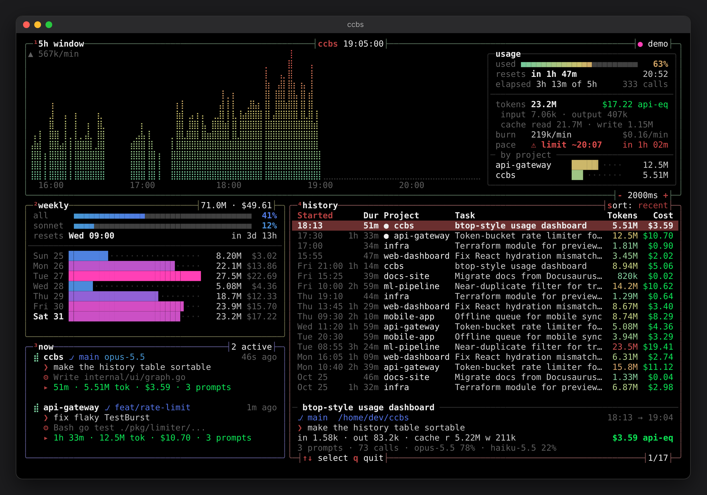
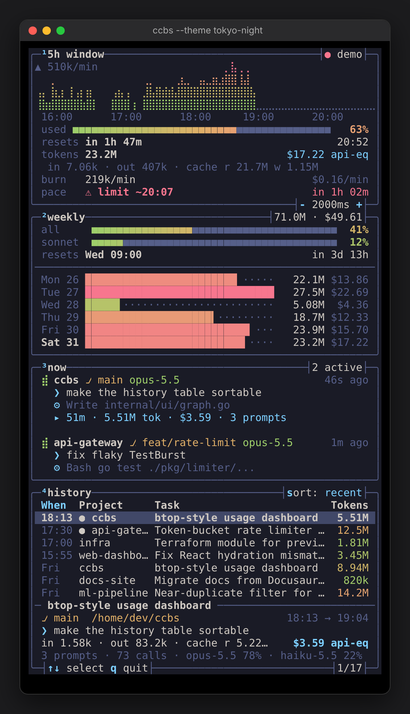
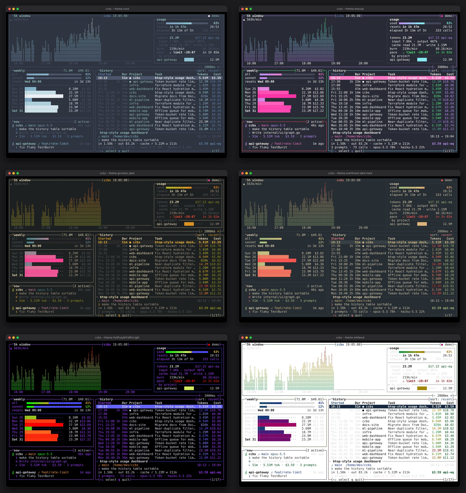

# ccbs

**Claude Code better status.** A [btop](https://github.com/aristocratos/btop)-style terminal dashboard for your Claude Code usage. It shows how much of your 5-hour and weekly limits you've used, how long until they reset, what you're working on right now, and what every past session cost in tokens.

**Website:** https://heyjeay.github.io/ccbs/ (moves to `/ccbs/` once the repo is renamed)



<p align="center"></p>

## Install

**macOS / Linux**

```sh
curl -fsSL https://heyjeay.github.io/ccbs/install.sh | sh
```

**Windows (PowerShell)**

```powershell
irm https://heyjeay.github.io/ccbs/install.ps1 | iex
```

**With Go**

```sh
go install github.com/heyjeay/ccbs@latest
```

The installers download the latest [release](https://github.com/heyjeay/ccbs/releases) for your OS and CPU, verify its SHA-256 checksum, and put `ccbs` in `~/.local/bin` (or `%LOCALAPPDATA%\ccbs` on Windows). No sudo or admin rights are needed.

## Panels

| # | Box | What it shows |
|---|-----|---------------|
| ¹ | **5h window** | Braille graph of token burn across the current 5-hour window. The usage panel shows % used, time until reset, tokens (input / output / cache), API-equivalent cost, burn rate, a **pace** forecast ("⚠ limit ~20:07" or "✓ safe until reset"), and a per-project breakdown. |
| ² | **weekly** | Weekly limit meters (all models, plus per-model limits when your plan has them), the reset time, and per-day token bars for the last 7 days. |
| ³ | **now** | Sessions active in the last 15 min: project, git branch, model, your latest prompt, the last tool Claude ran, and session totals. |
| ⁴ | **history** | Process-list style table of every session: start time, duration, project, task title, model, tokens, and cost. The selected row expands into a detail pane with the full token breakdown and model mix. |

The layout adapts to the terminal size. At 100+ columns you get the btop grid. Narrower terminals (phones over SSH, tmux splits) get a stacked layout.

## Themes

All 41 themes that ship with btop are built in, plus btop's own Default, for 42 in total. Press `t` / `T` to flip through them; ccbs remembers your choice in `~/.config/ccbs/ccbs.conf`.

```sh
ccbs --list-themes
ccbs --theme tokyo-night
ccbs --theme ~/my-colors.theme      # any btop .theme file
```

ccbs also loads `.theme` files from `~/.config/ccbs/themes`, `~/.config/btop/themes` and `/usr/share/btop/themes`, so btop themes you already have work too. A user file with the same name replaces the built-in one.



## Usage

```sh
ccbs              # live dashboard
ccbs --demo       # explore with generated sample data
ccbs --offline    # don't contact Anthropic; estimate limits locally
ccbs --snapshot --width 120 --height 40   # print one frame and exit
```

| Key | Action |
|-----|--------|
| `↑` `↓` / `j` `k` | select a history row |
| `PgUp` `PgDn` `g` `G` | jump through the history |
| `s` / `Tab` | cycle sort: recent → tokens → cost → duration |
| `t` / `T` | next / previous theme |
| `+` / `-` | change refresh interval |
| `r` | refresh now |
| `q` / `Ctrl-C` | quit |

## Where the numbers come from

- **Tokens, sessions, prompts, and tools** are read from Claude Code's local transcripts (`~/.claude/projects/**/*.jsonl`, or `$CLAUDE_CONFIG_DIR`). Files are tailed incrementally, so a refresh only reads newly appended bytes. Streamed responses that Claude Code logs more than once are de-duplicated by message and request ID.
- **5h and weekly utilization (%) and reset times** come from the same endpoint Claude Code's `/usage` screen uses (`api.anthropic.com/api/oauth/usage`). ccbs authenticates with your existing Claude Code login, read from `~/.claude/.credentials.json` or the macOS keychain. The token is only ever sent to `api.anthropic.com`. ccbs polls about once a minute and shows `● live` in the top-right corner.
- **Offline / estimated mode** (`--offline`, or when no login is found): the 5h window is reconstructed ccusage-style (it starts at the top of the hour of your first message), and % used is estimated against your most expensive previous window. The weekly box becomes a rolling 7-day view. The corner shows `● local est.`
- **Cost** is the API-equivalent price at published per-token rates, including cache-write (5m / 1h) and cache-read pricing. It's a yardstick for how heavy a session was, not what your subscription bills you.

## Development

```sh
go test ./...
go run . --demo
go run ./cmd/sitegen -out _site    # build the website into _site/
```

- `main.go`: the CLI.
- `internal/usage`: transcript parsing, windows, pricing, and live limits.
- `internal/ui`: the renderer, a cell canvas that emits truecolor escapes the way btop does (and HTML for the website).
- `internal/ui/themes`: btop's theme files.
- `site/`: the website. Its preview frames are rendered by ccbs itself, in every theme, at build time.

Releases are built by `.github/workflows/release.yml` whenever a `v*` tag is pushed. The website deploys from `main` via `.github/workflows/pages.yml`.

## Credits

ccbs's look and its bundled themes come from [btop](https://github.com/aristocratos/btop) by Jakob P. Liljenberg (aristocratos) and the theme authors credited in each file. They're used under the Apache-2.0 license (see `internal/ui/themes/LICENSE-btop`). ccbs itself is GPL-3.0.

ccbs is a community project. It isn't affiliated with or endorsed by Anthropic.
